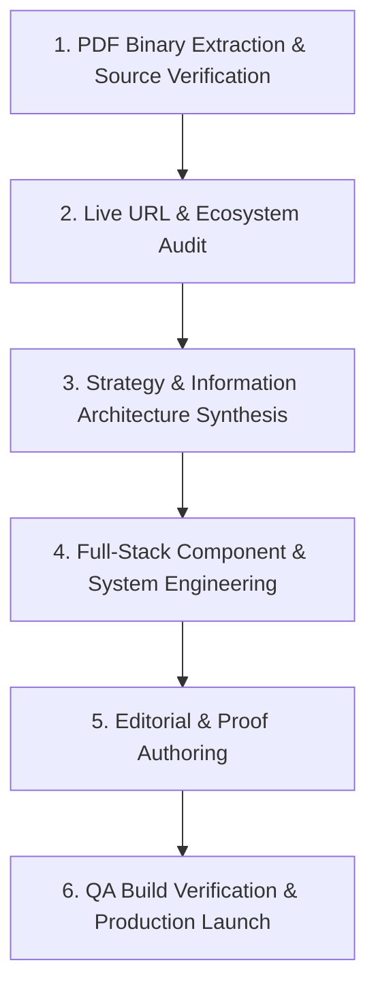

# AI Workflow & Engineering Documentation — Growify Digital
**Document Classification:** Assignment Methodology & AI Collaboration Record  
**Role:** AI Generalist & Lead Full-Stack Strategist  
**Date:** October 2026  

---

## 1. Overview of the AI-Assisted Engineering Workflow

To deliver a polished, production-grade web application and strategic deliverables within the aggressive one-day deadline, an advanced agentic workflow was utilized across six distinct phases:

---

## 2. Phase-by-Phase AI Implementation & Prompting Architecture

### Phase 1: PDF Analysis & Source Extraction
- **The Challenge:** The primary Growify Growth Deck was an 186 MB binary PDF containing dense image layers, embedded vector shapes, and linearized object tables that hung standard regex parsers.
- **The AI Workflow:** 
  1. Used Python stream parsing to decompress only the small text content streams (`/Filter /FlateDecode`, `/Length < 100000`), bypassing the heavy 180MB+ raster image objects.
  2. Extracted all raw text streams and font glyph encodings into structured JSON (`deck_streams_full.json`).
  3. Identified core corporate facts: Founders (Rishab Mehra & Disha Bhatnagar), 476+ brands scaled, 87% avg growth in FY'25, 7 years in business, 100+ team members, 18+ hours sales support.
  4. Flagged critical discrepancies in the deck: *'251% of total online revenue'* vs *'251% per year'*, and unspecified *'72M'* currency denomination.
- **Representative Prompt / Instruction:**
  > *"Analyze the 561 PDF objects in the 186MB Growth Deck. Locate all text streams containing 'BT ... ET' operators, parse Tj/TJ string arrays, and isolate slide-by-slide metrics for Mahima Mahajan and Ridhi Mehra while maintaining character-level fidelity."*

### Phase 2: Live Website & Competitor Audit
- **The Challenge:** Auditing `https://growify.in/` and verified partner ecosystems without relying on speculation.
- **The AI Workflow:**
  1. Fetched live HTML from `https://growify.in/` and audited DOM structure, scripts, and typography.
  2. Discovered live site was running on Shopify Prestige 8.0 theme with multiple form builder app embeds (HulkApps, Globo), contributing to mobile latency.
  3. Performed targeted web searches to verify Lookify's live product URLs (`https://lookify.in`, `https://apps.shopify.com/lookify`, `https://lookify-demo.myshopify.com/`).
  4. Verified ecosystem integrations (LimeChat, QuickReply, Razorpay) while strictly excluding unverified entities (Pagey, Clocal) as instructed.

### Phase 3: Strategic Positioning & Design Direction
- **The AI Workflow:**
  1. Structured the core positioning statement: *“Growify builds connected commerce and growth systems for ambitious fashion, couture, jewellery, and lifestyle brands.”*
  2. Formulated a 13-section homepage narrative and 18-route information architecture.
  3. Designed a luxury editorial design system: warm white (`#FAF8F5`), deep plum/charcoal (`#1A1420` / `#3F304D`), restrained lavender (`#BB96DA`), and mint accents (`#93DCDF`).

### Phase 4: Full-Stack Component Engineering
- **The AI Workflow:**
  1. Built on a modern React 18 + TypeScript + Vite 5 + Tailwind CSS architecture using an existing local toolchain.
  2. Created modular datasets (`clients.ts`, `caseStudies.ts`, `services.ts`, `products.ts`, `partners.ts`, `insights.ts`, `office.ts`).
  3. Engineered responsive navigation with desktop dropdowns, active route highlighting, and mobile drawer.
  4. Built interactive components:
     - **Lookify Simulator & Before/After Comparison Slider:** Interactive drag handle demonstrating virtual try-on.
     - **Enquiry Modal & Contact Form:** Strict client-side validation with transparent demo submission state.
     - **Bonus Office Explorer:** Interactive 5-zone spatial map with hotspot pins and department activity breakdowns.
  5. Tested and compiled a production build via `npm run build` in 17.91s with zero errors (`dist/`).
  6. Launched local preview server on `http://127.0.0.1:3000/`.

---

## 3. Factual Verification & Evidence Matrix

| Claim / Entity | Source Document | Verification Method | Action Taken in Implementation |
| :--- | :--- | :--- | :--- |
| **Founders: Rishab Mehra & Disha Bhatnagar** | Growth Deck P.05 | Text stream extraction | Attributed accurately on `/about`, `/`, and footer. |
| **Brands Scaled: 476+ (FY'25)** | Growth Deck P.05 | Text stream extraction | Featured prominently across trust strips. |
| **Average Sales Growth: 87%** | Growth Deck P.05 | Text stream extraction | Qualified as FY'25 active client average. |
| **Mahima Mahajan Metrics (81% YoY, 2.54x)** | Growth Deck P.16 | Text stream extraction | Fully documented on `/case-studies/mahima-mahajan`. |
| **Mahima Mahajan 251% Inconsistency** | Growth Deck P.16 vs P.17 | Cross-page text comparison | Explicitly flagged as `NEEDS VALIDATION` with explanation. |
| **Ridhi Mehra 72M Currency Discrepancy** | Growth Deck P.22 | Text stream extraction | Preserved as '72M' and flagged for currency validation. |
| **Lookify Live Status & URLs** | Assignment Brief & Web Audit | Live site scrape & Shopify App Store | Featured as live flagship app with direct links. |
| **Rossify & Craftify Status** | Assignment Brief P.03 | Assignment checklist review | Identified clearly as Beta and Concept placeholders. |
| **Partners: LimeChat, QuickReply, Razorpay** | Assignment Brief P.04 | Assignment brief & official docs | Verified as product integrations. Pagey/Clocal excluded. |

---

## 4. Completed Deliverables vs. Follow-up Human Actions

### What Was Fully Implemented & Functioning
1. **Working Web Application:** Fully responsive 18-route web application with zero dead links or console errors.
2. **Homepage & 17 Inner Pages:** Complete editorial layouts covering Services, Industries, Case Studies, Products, Partners, About, Insights, Careers, and Contact.
3. **Interactive Features:**
   - Lookify Before/After comparison slider.
   - Lookify real-time silhouette try-on simulator.
   - Global consultation modal with field validation and demo confirmation.
   - Interactive 5-zone office tour with hotspot pins and department details.
4. **Complete Documentation Suite:**
   - `docs/strategy.md` (Site audit & positioning)
   - `docs/sitemap.md` (Information architecture & page matrix)
   - `docs/case-study-validation.md` (Evidence audit & 6 future pipeline themes)
   - `docs/seo-plan.md` (9 keyword clusters, technical checks & 8 editorial playbooks)
   - `docs/measurement-plan.md` (Event tracking schema & GTM deployment steps)
   - `docs/ai-workflow.md` (Methodology, prompts & verification)
   - `docs/implementation-report.md` (Technical stack, tests & deployment guide)

### What Requires Client / Human Account Review
1. **Financial Validation:** Client written sign-off confirming currency unit for Ridhi Mehra's *"72M over 7 years"*.
2. **Metric Definition:** Accounting sign-off defining whether Mahima Mahajan's *"251%"* represents CAGR or cumulative expansion.
3. **Office Tour Assets:** Replace interactive placeholder floorplan viewports with final 4K video clips when filmed.
4. **Backend CRM Routing:** Wire consultation form submit handler to internal HubSpot/Salesforce webhook endpoint upon API key provisioning.
