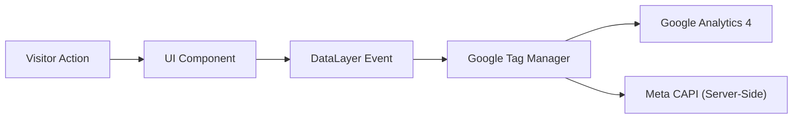

# Conversion Tracking & Analytics Measurement Plan — Growify Digital
**Document Classification:** Internal Analytics Specification  
**Author:** CRO & Analytics Specialist  
**Date:** October 2026  
**Status:** Recommended Measurement Schema (Ready for Tag Manager / Segment Deployment)

---

## 1. Analytics Architecture Overview

To maintain strict compliance with assignment guidelines, this document distinguishes **proposed analytics instrumentation** from active production telemetry. In the current prototype build, events and demo form submissions are simulated client-side with full accessible validation. The specification below outlines the exact schema to be integrated once production Google Tag Manager (GTM) or Segment container keys are provisioned.

---

## 2. Event Taxonomy & Property Schema

| Event Name | Trigger Condition | Core Event Properties | Business Purpose / KPI |
| :--- | :--- | :--- | :--- |
| **`cta_click`** | User clicks any primary conversion button (e.g. *“Discuss your growth”*, *“Schedule Audit”*). | `cta_text`: String `cta_location`: String (e.g. `header`, `hero`, `case_study_card`) `target_service`: String `page_path`: String | Measures CTA prominence and intent-to-consult across varied page layouts. |
| **`navigation_click`** | User interacts with top navbar, dropdown items, or mobile drawer links. | `nav_item_name`: String `nav_type`: String (`desktop_header`, `dropdown`, `mobile_drawer`) `destination_url`: String | Identifies high-friction user paths and primary discovery flows. |
| **`case_study_view`** | User opens or scrolls into a specific case study section or deep-dive page. | `case_study_slug`: String (`mahima-mahajan`, `ridhi-mehra`) `client_name`: String `scroll_depth_threshold`: Number (25%, 50%, 75%, 100%) | Measures commercial proof engagement and depth of prospect due diligence. |
| **`product_demo_click`** | User interacts with Lookify interactive simulator, before/after slider, or external demo store link. | `product_id`: String (`lookify`, `rossify`, `craftify`) `interaction_type`: String (`simulate_tryon`, `drag_slider`, `external_demo_link`) `destination_url`: String | Quantifies interest in Growify's proprietary software ecosystem. |
| **`form_start`** | User focuses on the first input field (`fullName`) inside the consultation modal or contact page. | `form_id`: String (`enquiry_modal`, `contact_page`) `service_preselected`: String `page_path`: String | Benchmarks initial conversion intent before form abandonment. |
| **`form_submit_success`** | User successfully satisfies all validation rules and submits the consultation request. | `form_id`: String `service_interest`: String `monthly_gmv_bracket`: String `submission_timestamp`: ISO 8601 String | Primary Macro-Conversion: Qualified inbound sales consultation lead. |
| **`contact_link_click`** | User clicks direct phone number (`tel:`), direct email (`mailto:`), or physical office map. | `contact_method`: String (`phone`, `email`, `address`) `contact_value`: String (`+918800461296`, `info@growify.in`) | Secondary Conversion: Direct offline boutique/phone inquiry. |

---

## 3. Macro & Micro Conversion Definitions

### Macro-Conversions (Primary Commercial Milestones)
1. **Qualified Consultation Submission (`form_submit_success`):**
   - *Definition:* Completed brief submission with valid work email, company name, and explicit growth bottleneck description.
   - *Estimated Value / Weight:* High commercial intent (Tier 1).
2. **Direct Executive Contact (`contact_link_click` on Phone / Founder Email):**
   - *Definition:* Immediate inbound call or direct message to Growify leadership.

### Micro-Conversions (Leading Engagement Indicators)
1. **Lookify Demo Engagement (`product_demo_click`):** Testing the virtual try-on simulator indicates high curiosity regarding AI product capabilities.
2. **Proof Deep-Dive (`case_study_view` > 75% scroll):** Indicates deep evaluation of Growify's operational track record.
3. **Office Experience Tour (`/life-at-growify` Hotspot Interaction):** Reflects cultural affinity and agency qualification.

---

## 4. Privacy, GDPR & Consent Architecture

1. **Zero Cookie Banner Bloat:** The current prototype uses zero non-essential tracking cookies, ensuring maximum initial page load speed.
2. **PII Protection:** Email addresses and phone numbers collected in forms must never be passed in cleartext inside query strings or GA4 event parameters.
3. **Ephemeral Lookify Processing:** In production, customer selfie uploads for Lookify virtual try-on must be processed ephemerally in RAM and wiped immediately post-inference, respecting international GDPR, California CCPA, and India Digital Personal Data Protection (DPDP) Act standards.

---

## 5. Required Implementation Steps for Production Launch

1. **Tag Management Container:** Create a verified Google Tag Manager container (`GTM-XXXXXXX`) and insert head script into `index.html`.
2. **Server-Side Proxy:** Deploy a Cloudflare or Stape server-side GTM proxy to bypass ad-blockers and feed Meta CAPI directly.
3. **CRM Webhook Bridge:** Connect the consultation form submit handler to Growify's internal HubSpot / Salesforce pipeline via an authenticated HTTPS API endpoint.
4. **Attribution Telemetry:** Implement UTM parameter preservation across multi-page sessions to measure campaign-level acquisition efficiency.
