# Information Architecture & Sitemap — Growify Digital
**Document Classification:** Internal Technical & Product Architecture  
**Date:** October 2026  
**Implementation Status:** All 18 Routes Live in Local Production Preview (`http://127.0.0.1:3000/`)

---

## 1. Global Navigation Architecture

The site architecture is designed around the **Connected Growth System**, leading high-net-worth brand decision-makers smoothly from discovery to evidence-based proof, product exploration, and qualified consultation requests.

```mermaid
graph TD
  Root["/ (Homepage)"] --> Services["/services (Connected Capabilities)"]
  Root --> Industries["/industries (Vertical Expertise)"]
  Root --> CaseStudies["/case-studies (Proof & Pipeline)"]
  Root --> Products["/products (Proprietary AI Tech)"]
  Root --> Partners["/partners (Ecosystem & Integrations)"]
  Root --> About["/about (Company & Leadership)"]
  Root --> Life["/life-at-growify (Interactive Studio Tour)"]
  Root --> Insights["/insights (8 Editorial Playbooks)"]
  Root --> Careers["/careers (Open Roles)"]
  Root --> Contact["/contact (Strategic Consultation)"]

  Services --> Commerce["/services/commerce (Shopify & Liquid)"]
  Services --> Growth["/services/growth (Performance, WhatsApp & Retention)"]

  CaseStudies --> Mahima["/case-studies/mahima-mahajan (Couture Engine)"]
  CaseStudies --> Ridhi["/case-studies/ridhi-mehra (7-Year Scale)"]

  Products --> Lookify["/products/lookify (AI Virtual Try-On)"]
  Products --> Rossify["/products/rossify (Workflow Beta)"]
  Products --> Craftify["/products/craftify (Creative Concept)"]
```

---

## 2. Page Inventory, Target Audience & Conversion Path Matrix

| Priority | Route URL | Page Purpose | Primary Target Audience | Primary Call-to-Action (CTA) | Implementation Status |
| :---: | :--- | :--- | :--- | :--- | :--- |
| **P1** | `/` | Flagship homepage introducing connected commerce & growth positioning, verified client marquee, interactive Lookify simulator, and evidence previews. | Brand Founders, CEOs, Chief Commercial Officers | *“Discuss Your Growth”* (Triggers Global Modal) | Fully Implemented & Responsive |
| **P1** | `/services` | Comprehensive overview of Growify's connected capabilities across Storefront, Acquisition, Retention, Sales Ops, and Data. | Heads of D2C, E-commerce Directors, CMOs | *“Explore Service Specifications”* | Fully Implemented |
| **P1** | `/services/commerce` | Deep-dive technical specifications for bespoke Shopify Plus theme engineering, multi-currency pricing, and speed optimization. | Technical Founders, CTOs, E-Commerce Managers | *“Discuss Storefront Architecture”* | Fully Implemented |
| **P1** | `/services/growth` | Full-funnel performance marketing, WhatsApp CRM retention, 18-hour sales concierge, and fashion SEO. | Growth Leads, Performance Marketers, Media Buyers | *“Accelerate Customer Acquisition”* | Fully Implemented |
| **P2** | `/industries` | Vertical domain expertise across Haute Couture & Bridal, Fine Jewellery, Contemporary Pret, and Luxury Lifestyle. | Designer Founders & Luxury Category Heads | *“Book Category Strategy Session”* | Fully Implemented |
| **P1** | `/case-studies` | Portfolio proof index with detailed evidence policy and 6-part future case-study pipeline data checklist. | Agency Evaluators, Brand CEOs, Investors | *“Explore Documented Outcomes”* | Fully Implemented |
| **P1** | `/case-studies/mahima-mahajan` | Case study on scaling international couture (81% YoY online growth, 2.54x scale, RTS factory floor merchandising). | Global Couture Labels & Bridal Designers | *“Consult on Global Expansion”* | Fully Implemented |
| **P1** | `/case-studies/ridhi-mehra` | 7-year growth partnership case study (69% sales lift, 80%+ online share, WhatsApp assisted sales, dual-funnel UX). | Mature Fashion Houses & Atelier Owners | *“Discuss Long-Term Partnership”* | Fully Implemented |
| **P1** | `/products` | Proprietary software suite connecting growth services with technology tools (Lookify, Rossify, Craftify). | Digital Innovation Directors & E-commerce Heads | *“Explore Technology Ecosystem”* | Fully Implemented |
| **P1** | `/products/lookify` | Flagship AI virtual try-on product presentation with before/after comparison slider, verified metrics, and demo links. | Fashion Brand Founders, Retail VPs, VTO Evaluators | *“Try Live Demo Store”* (Official Link) | Fully Implemented |
| **P2** | `/products/rossify` | Clearly marked product overview for factory-floor merchandising and inquiry triage, including product-input checklist. | Merchandising Directors & Factory Operations Heads | *“Request Beta Briefing”* | Fully Implemented (Clear Beta Marker) |
| **P2** | `/products/craftify` | Clearly marked conceptual overview for generative catalog photography, including legal/technical checklist. | Creative Directors & Lookbook Stylists | *“Request Creative Consultation”* | Fully Implemented (Clear Concept Marker) |
| **P1** | `/partners` | Ecosystem page featuring verified product integrations (LimeChat, QuickReply, Razorpay, Shopify Plus, Klaviyo, Meta). | Chief Technology Officers & Systems Architects | *“Consult on Ecosystem Integrations”* | Fully Implemented |
| **P2** | `/about` | Company background (founded 2019 in New Delhi), founders Rishab Mehra & Disha Bhatnagar, 100+ team, core values. | Prospective Clients, Talent, Partners | *“Connect with Leadership Team”* | Fully Implemented |
| **Bonus**| `/life-at-growify` | Interactive 5-zone spatial office tour (Growth Floor, Commerce Lab, Creative Studio, Sales Desk, Town Hall) with hotspots. | Potential Hires, Prospective Clients, Evaluators | *“Schedule Studio Visit”* | Fully Implemented (Bonus Tour) |
| **P2** | `/insights` | 8 original strategic playbooks on luxury Shopify UX, high-AOV attribution, WhatsApp CRM, and virtual try-on ROI. | Fashion Marketers, Industry Researchers | *“Read Full Strategy Playbook”* | Fully Implemented (8 Full Playbooks) |
| **P2** | `/careers` | Culture overview and 4 open job descriptions (AI Generalist, Shopify Architect, Growth Lead, Luxury Sales Concierge). | Prospective Talent & Builders | *“Apply for Open Role”* | Fully Implemented |
| **P1** | `/contact` | Full contact experience with validated brief form, Delhi HQ address, direct phone/email, and transparent demo state. | All Inbound Prospects & Brand Custodians | *“Schedule Growth Architecture Audit”* | Fully Implemented |
