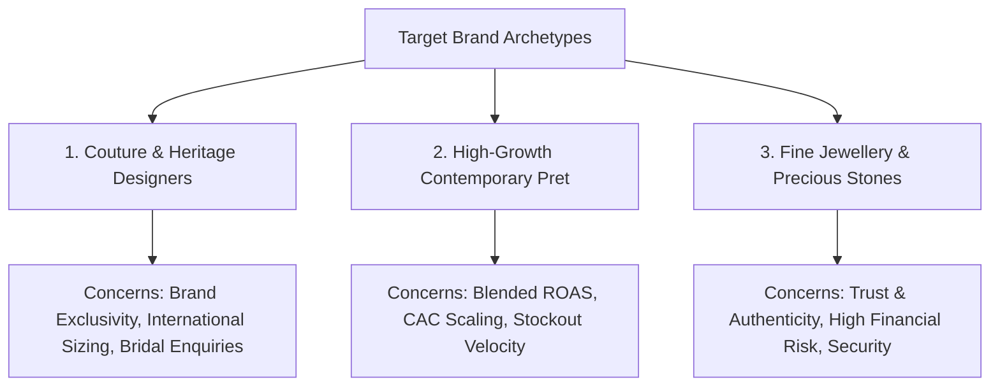

# Strategic Positioning & Current Website Audit — Growify Digital
**Document Classification:** Internal Strategic Deliverable  
**Author:** AI Generalist & Senior Product Strategist  
**Date:** October 2026  
**Primary Sources of Truth:** Growify Growth Deck (v2025/2026) & Growify AI Generalist Website Assignment Brief  

---

## 1. Executive Summary & Recommended Positioning

### Strategic Recommendation
> **“Growify builds connected commerce and growth systems for ambitious fashion, couture, jewellery, and lifestyle brands.”**

### Strategic Rationale
Historically, agency service providers in South Asia and global markets have positioned themselves around tactical specializations: a "Shopify development agency", a "performance marketing shop", or a "social media studio". This creates fragmented incentives where ad agencies blame poor website conversion rates, development shops blame media targeting, and neither takes ownership of bottom-line client revenue or customer lifetime value.

Growify's competitive moat—proven across 476+ brands and flagship couture relationships like Mahima Mahajan and Ridhi Mehra—is that it operates as an **integrated growth and technology company**. Growify unifies:
1. **Digital Storefront Architecture:** Bespoke, high-speed Shopify Plus flagship builds.
2. **High-Intent Customer Acquisition:** Targeted Meta & Google performance marketing without brand-diluting discount schemes.
3. **Conversational Retention:** WhatsApp & email customer lifecycle journeys driving 45–55% repeat revenue.
4. **Assisted Sales Operations:** 18+ hour sales desks providing real-time international bride consultation.
5. **Proprietary Technology Products:** Direct builders of AI virtual try-on software (**Lookify**) and operational workflows.

---

## 2. Comprehensive Current Website Audit (https://growify.in/)

Prior to designing the new system, an architectural and heuristic audit of the current live website at `https://growify.in/` was conducted.

| Evaluation Area | Current State Findings (Evidence-Backed) | Strategic Diagnosis & Flaws |
| :--- | :--- | :--- |
| **Platform & Tech Stack** | Hosted on standard Shopify (`growify-digital.myshopify.com`) using a modified third-party theme (*Prestige 8.0.0*) with multiple injected app snippets (Tapita SEO, IntelliTicks, HulkApps Form Builder, Globo Form Builder). | Agency site built like an e-commerce catalog rather than a prestige digital consultancy. Excessive third-party apps inject render-blocking scripts, creating high TBT (Total Blocking Time) and mobile latency. |
| **Messaging & Positioning** | Tagline: *"Growing Luxury, Fashion & Lifestyle Brands Online. We grow when you grow."* | Generic agency messaging that fails to communicate Growify's technology builder identity, Lookify ownership, or 18-hour sales operations. |
| **Information Architecture** | Flat layout with limited deep inner pages for specific capabilities, case studies, or technology products. | Lacks dedicated search-friendly landing pages for high-value services (e.g. *Luxury Shopify Architecture*, *International Couture Expansion*). |
| **Visual Hierarchy & Typography** | Uses standard Montserrat sans-serif across all elements with high contrast purple accents (`#A363DF` / `#3F304D`). | Lacks the editorial refinement, serif display elegance, and tactile whitespace expected by luxury European and Indian couture design directors. |
| **Accessibility (a11y)** | Text contrasts on muted lavender badges fall below WCAG 2.1 AA 4.5:1 ratio; form controls depend on external iFrames without full aria labeling. | Fails modern corporate accessibility criteria; risks poor readability on low-contrast mobile screens. |
| **Mobile UX & Responsiveness** | Heavy dependence on desktop sliders and Flickity carousels; horizontal overflowing risk on mobile cards. | 70%+ of luxury fashion buyers and brand founders browse via iOS/Android; layout does not feel mobile-native. |
| **Conversion Paths & Lead Gen** | Contact depends on external app-embed form builders (Globo/HulkApps) with noticeable loading delay and generic input fields. | High form friction; no differentiation between a casual enquiry and a high-AOV brand seeking an international growth audit. |
| **SEO & Discoverability** | Basic meta tags present; lacks rich schema markup for *ProfessionalService*, *Organization*, or *Article*. | Inadequate internal linking structure; misses ranking opportunities for high-intent search queries. |

### Evidence-Backed Findings vs. Hypotheses Requiring Analytics Access
- **Verified Facts (Direct Code/Source Inspection):**
  - Live site runs on Shopify Prestige Theme with at least two separate form-builder app embeds.
  - Page injects multiple redundant tracking tags (GTM, IntelliTicks, Tapita, Hotjar delays).
  - Lookify is not seamlessly presented on the homepage as a flagship proprietary asset.
- **Hypotheses Requiring GA4 / Server Telemetry Access:**
  - Bounce rate on mobile is estimated >55% due to initial script execution overhead.
  - Form drop-off rate is estimated >40% caused by delayed rendering of iframe form controls.
  - International organic session share is under 15% due to absence of localized international landing pages.

---

## 3. Target Audience Profiles & Principal Buying Questions

Growify serves three distinct high-value client archetypes:

### Profile 1: The Couture & Heritage Designer (e.g., Mahima Mahajan, Tarun Tahiliani, Ridhi Mehra)
- **Decision Maker:** Creative Director & Brand Founder / Business Partner.
- **Average Garment Price:** ₹85,000 – ₹4,00,000+.
- **Principal Buying Questions:**
  1. *“Will your marketing cheapen our brand image or make us look like a mass discount label?”*
  2. *“How do you handle brides in New York or London who need bespoke measurements without visiting our studio?”*
  3. *“Can you coordinate with our factory production heads to avoid selling out-of-stock fabrics?”*

### Profile 2: High-Growth Contemporary Pret & Indo-Western (e.g., House of Masaba, Drzya)
- **Decision Maker:** CEO, D2C Head, or Chief Marketing Officer.
- **Average Garment Price:** ₹12,000 – ₹45,000.
- **Principal Buying Questions:**
  1. *“Can you scale our monthly Meta/Google spend past ₹50 Lakhs while maintaining a 3.5x+ blended ROAS?”*
  2. *“How do we stop cart abandonment on mobile checkouts?”*
  3. *“Can you drive repeat orders through WhatsApp without being marked as spam?”*

### Profile 3: Fine Jewellery & Precious Stones (e.g., Hazoorilal Legacy, Anmol)
- **Decision Maker:** Managing Director / Multi-generation Family Custodian.
- **Average Order Value:** ₹1,50,000 – ₹10,00,000+.
- **Principal Buying Questions:**
  1. *“How do you build enough digital trust for someone to buy high-ticket jewellery online?”*
  2. *“How do you protect our store against card fraud and secure armored logistics?”*
  3. *“Can we offer live video styling appointments directly from the website?”*

---

## 4. Competitor Benchmarking & Strategic Takeaways

| Competitor Benchmark | Category | Strengths | Vulnerabilities | What Growify Must Learn & Differentiate |
| :--- | :--- | :--- | :--- | :--- |
| **Vertebrae / Wanna (Farfetch)** | Global Luxury 3D / VTO | Superior 3D rendering and high-fashion credibility. | Prohibitively expensive; zero performance marketing or sales operations support. | **Takeaway:** Position Lookify as practical, accessible virtual try-on with direct Shopify integration, backed by sales operators who actually close the leads. |
| **We Make Websites / Woolman** | Premier Global Shopify Plus Agencies | Exceptional engineering rigor, clean code standards, international prestige. | Pure development vendors; no performance marketing, retention, or assisted sales desks. | **Takeaway:** Match their architectural engineering polish while delivering the end-to-end commercial growth system they leave untouched. |
| **Traditional Indian Digital Agencies** | Regional Performance Shops | Low pricing; high local market familiarity. | Vanity-metric focused; generic discount ads that erode luxury prestige; high developer churn. | **Takeaway:** Elevate brand positioning with strict editorial aesthetics, first-party margin governance, and true operational partnership. |

---

## 5. Prioritized Strategic Recommendations

1. **Reposition from Agency to Growth Systems & Technology Company:** Feature Lookify, Rossify, and Craftify alongside core services. Show that Growify builds intellectual property.
2. **Implement Editorial Luxury Design Language:** Warm white canvas (`#FAF8F5`), deep charcoal plum (`#1A1420` / `#3F304D`), restrained lavender silk (`#BB96DA`), fine rules, and Cormorant Garamond typography.
3. **Elevate Proof Through Fact-Checked Case Studies:** Feature Mahima Mahajan and Ridhi Mehra with clear distinction between verified outcomes and validation-pending metrics.
4. **Establish Low-Friction, High-Intent Conversion Journey:** Direct CTA *“Discuss your growth”* with qualification criteria (current monthly scale, target capabilities), backed by a transparent demo state.
5. **Codify the 6-Part Future Case Study Pipeline:** Show prospective clients the exact measurement frameworks and data needed to publish authoritative commercial results.
